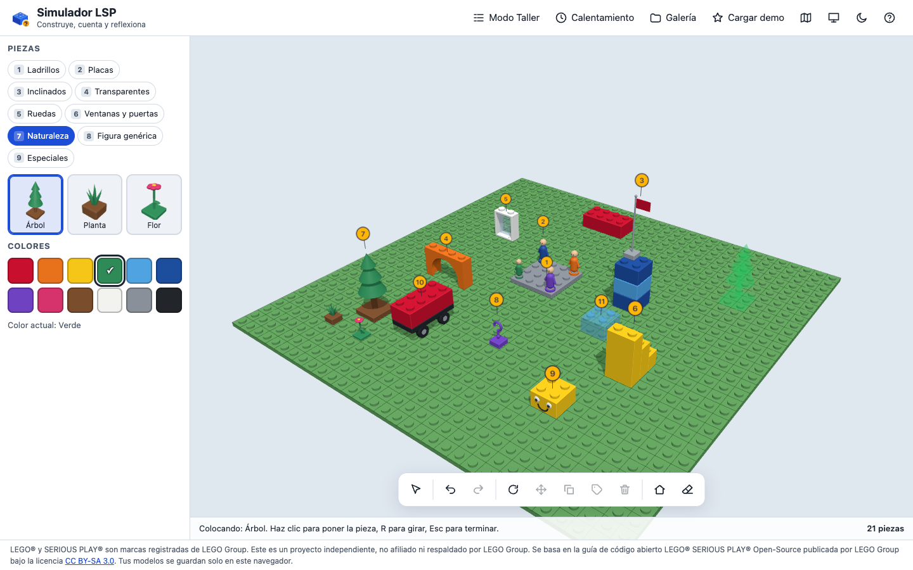
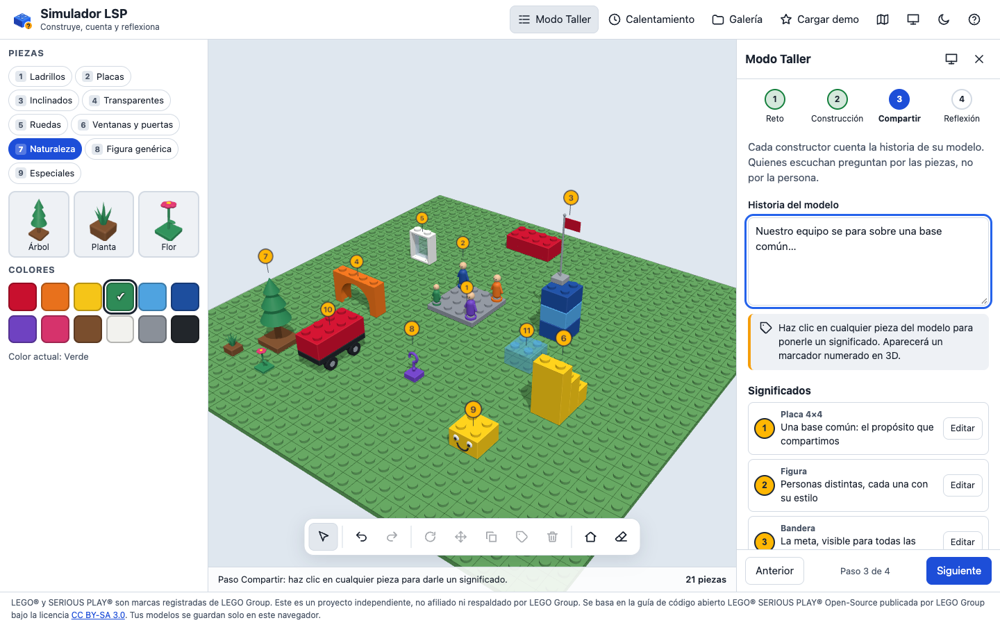
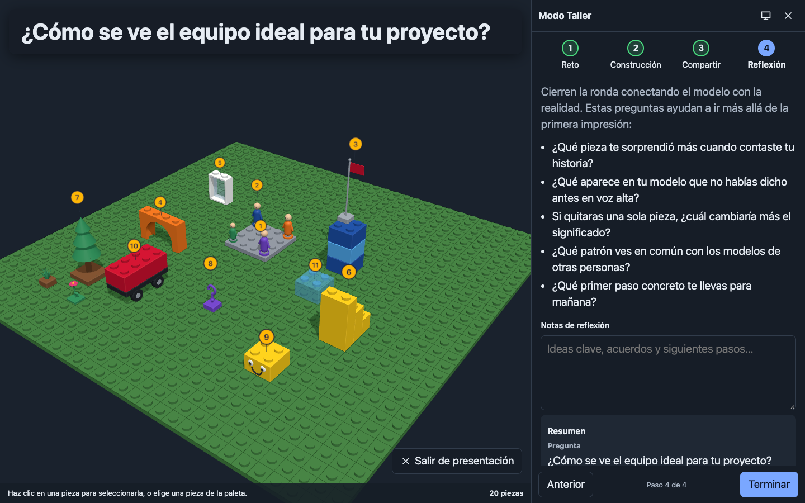

# Simulador LSP

Simulador 3D de construcción con ladrillos para talleres inspirados en la metodología **LEGO® SERIOUS PLAY®**. Construyes un modelo en tu navegador, le pones significado a cada pieza y facilitas una sesión guiada de 4 pasos: reto, construcción, compartir y reflexión.

Funciona 100 % en el navegador: no hay servidor, cuentas ni rastreadores. Tus modelos se guardan solo en tu equipo.

**👉 Pruébalo en línea: <https://atapia9.github.io/simulador-lsp/>**

> Proyecto independiente, sin afiliación ni respaldo de LEGO Group. Consulta el [aviso de marcas](#aviso-de-marcas-y-créditos).

## Capturas

| Constructor 3D | Modo Taller (Compartir) |
| --- | --- |
|  |  |



## Funciones

**Constructor 3D**

- Base de 32 × 32 espigas con rejilla visible.
- Cámara para girar, acercar y desplazar, con botón **Restablecer vista**.
- Colocación por rejilla sobre la base o encima de otras piezas, con vista previa translúcida: **verde** si cabe, **roja** si choca, se sale de la base o queda en el aire.
- Detección de choques con una rejilla de ocupación en placas (1 ladrillo = 3 placas).
- Seleccionar, mover, girar 90°, cambiar color, duplicar y eliminar piezas.
- Deshacer y rehacer (hasta 100 pasos) y **Limpiar todo** con confirmación.
- 33 piezas en 9 categorías: ladrillos, placas, inclinados, transparentes, ruedas, ventanas y puertas, naturaleza, figura genérica y especiales (bandera, escalera, arco, cara con ojos, signo de interrogación).
- 12 colores con nombre y contador de piezas.
- Atajos de teclado y soporte táctil para tabletas.

**Modo Taller**

1. **Reto:** escribe la pregunta o elige una de 10 preguntas de ejemplo (equipos, liderazgo, educación y estrategia).
2. **Construcción:** temporizador de 1 a 15 minutos con barra de progreso y campanita suave opcional (generada con Web Audio).
3. **Compartir:** escribe la historia del modelo y haz clic en cualquier pieza para ponerle un significado. Aparece un marcador numerado en 3D y en la lista lateral.
4. **Reflexión:** preguntas para profundizar, notas y un resumen que puedes copiar o guardar.

También incluye **Modo presentación** (pantalla completa con texto grande) y **Calentamiento** con 4 ejercicios cortos, cada uno con su temporizador.

**Galería y archivos**

- Guarda varios modelos con nombre (pregunta, historia, significados y fecha) en el navegador.
- Exporta e importa modelos en JSON con formato versionado y mensajes de error claros.
- Descarga una imagen PNG de la vista actual.
- Comparte modelos pequeños con un enlace (el modelo viaja en la URL, no en un servidor).

**Demo y ayuda**

- En la primera visita se carga un modelo de ejemplo: *“¿Cómo se ve el equipo ideal para tu proyecto?”*.
- Botón **Cargar demo** y enlace directo con `?demo=1`, que además abre el recorrido.
- Recorrido guiado de 6 pasos por la interfaz.

**Accesibilidad**

- Tema claro y oscuro que sigue al sistema, con botón para cambiarlo.
- Todos los controles funcionan con teclado, con foco visible y etiquetas en español.
- Respeta *reducir movimiento* del sistema.
- En teléfono muestra una vista simplificada y recomienda una pantalla más grande.

## Aviso de marcas y créditos

LEGO® y SERIOUS PLAY® son marcas registradas de LEGO Group. Este es un proyecto independiente, no afiliado ni respaldado por LEGO Group.

Este proyecto se basa en la guía **LEGO® SERIOUS PLAY® Open-Source** publicada por LEGO Group bajo la licencia [Creative Commons Atribución-CompartirIgual 3.0 (CC BY-SA 3.0)](https://creativecommons.org/licenses/by-sa/3.0/). Los textos de metodología de la app y de esta documentación están escritos con palabras propias.

Las piezas son ladrillos genéricos y la figura humana es un diseño original. No se usan logotipos, fuentes, fotos ni nombres o números de sets oficiales.

## Requisitos

- [Node.js](https://nodejs.org/) LTS (probado con v24; recomendado el LTS más reciente) y npm.
- Un navegador reciente con WebGL: Chrome, Edge, Firefox o Safari.

## Instalación local

```bash
npm install
```

```bash
npm run dev
```

Abre la dirección que muestra la terminal (por ejemplo `http://localhost:5173/simulador-lsp/`).

```bash
npm test
```

```bash
npm run build
```

Para revisar el sitio ya construido, igual que en GitHub Pages:

```bash
npm run preview
```

Prueba de humo con Playwright y capturas para este README (con `npm run preview` corriendo en otra terminal):

```bash
npx playwright install chromium
```

```bash
npm run capturas
```

## Cómo se usa

### Constructor

1. Elige una categoría y una pieza en la paleta de la izquierda.
2. Mueve el cursor sobre la base: la vista previa verde indica dónde cabe.
3. Haz clic para colocarla. Puedes seguir colocando la misma pieza; pulsa **Esc** para terminar.
4. En modo selección, haz clic en una pieza para seleccionarla y usa la barra inferior para girarla, moverla, duplicarla, ponerle significado o eliminarla. Elige un color para cambiar el de la pieza seleccionada.

### Atajos de teclado

| Tecla | Acción |
| --- | --- |
| `1` – `9` | Abrir una categoría de la paleta |
| `R` | Girar 90° (pieza nueva o seleccionada) |
| `M` | Mover la pieza seleccionada |
| `D` | Duplicar la pieza seleccionada |
| `S` | Agregar significado |
| `Supr` / `Delete` | Eliminar la pieza seleccionada |
| `Ctrl + Z` | Deshacer |
| `Ctrl + Y` / `Ctrl + Shift + Z` | Rehacer |
| `Esc` | Cancelar la acción actual |
| Flechas + `Enter` | Mover la vista previa y colocar sin ratón (con el foco en el área 3D) |
| `?` | Mostrar los atajos |

Con el ratón: arrastra para girar la cámara, usa clic derecho para desplazarla y la rueda para acercar. En tableta: un dedo gira, dos dedos acercan y desplazan, y un toque coloca o selecciona.

### Modo Taller paso a paso

1. Abre **Modo Taller** en la barra superior.
2. **Reto:** escribe la pregunta o elige una de ejemplo y pulsa *Usar esta pregunta*.
3. **Construcción:** ajusta los minutos y pulsa *Iniciar*. Al terminar suena una campanita (si está activada).
4. **Compartir:** escribe la historia. Haz clic en las piezas importantes y escribe qué significan.
5. **Reflexión:** conversa con las preguntas guía, toma notas y copia el resumen o guárdalo en la galería.
6. Para proyectar, usa el botón de **presentación** (pantalla) y sal con `Esc`.

Hay una guía para facilitar una sesión de 60 a 90 minutos en [docs/GUIA-FACILITADOR.md](docs/GUIA-FACILITADOR.md).

## Cómo agregar piezas nuevas

Las piezas son datos en [`src/data/piezas.js`](src/data/piezas.js). Agrega un objeto a la lista `PIEZAS`:

```js
{ id: 'ladrillo-1x6', nombre: 'Ladrillo 1×6', categoria: 'ladrillos', forma: 'ladrillo', ancho: 6, fondo: 1, alto: 3 },
```

- `ancho` y `fondo` se miden en espigas; `alto` en placas (un ladrillo = 3, una placa = 1).
- `forma` elige la geometría: `ladrillo`, `inclinado`, `ruedas`, `ventana`, `puerta`, `arbol`, `planta`, `flor`, `figura`, `bandera`, `escalera`, `arco`, `cara` o `interrogacion`. Las formas `ladrillo` e `inclinado` se adaptan a cualquier tamaño.
- Opcionales: `transparente: true` y `color: '#rrggbb'` (color inicial).

Para una forma totalmente nueva, agrega una función en `FORMAS` dentro de [`src/escena/formas.js`](src/escena/formas.js). Las colisiones usan la caja `ancho × fondo × alto`, así que no necesitas tocar el núcleo.

## Despliegue en GitHub Pages

**Automático:** cada push a `main` ejecuta [.github/workflows/deploy.yml](.github/workflows/deploy.yml): instala dependencias, corre las pruebas, construye y publica `dist/` en GitHub Pages.

La primera vez, activa Pages en **Settings → Pages → Source: GitHub Actions**, o con:

```bash
gh api -X POST repos/USUARIO/simulador-lsp/pages -f build_type=workflow
```

**Manual:** desde la pestaña **Actions**, elige *Desplegar en GitHub Pages* y pulsa **Run workflow**.

Si cambias el nombre del repositorio, actualiza `base` en [`vite.config.js`](vite.config.js) (por ejemplo `'/mi-repo/'`).

## Estructura del proyecto

```
index.html
src/
  main.js            # arma la interfaz y conecta todo
  estilos.css
  escena/            # Three.js: render, cámara, geometrías, raycasting
  nucleo/            # lógica pura sin Three.js: rejilla, colisiones, deshacer, formato JSON, almacén
  taller/            # flujo del taller, temporizador y sonido
  ui/                # paleta, constructor, diálogos, galería, recorrido, tema
  data/              # piezas, colores, preguntas, ejercicios y demo
  i18n/es.js         # todos los textos de la interfaz
test/                # pruebas con node --test
scripts/capturas.mjs # prueba de humo y capturas con Playwright
docs/                # guía del facilitador e imágenes
```

## Limitaciones conocidas

- Las colisiones usan la caja completa de cada pieza: no puedes meter piezas bajo un arco o una escalera.
- Una pieza se apoya si al menos una espiga toca algo debajo. Si quitas o mueves la pieza de abajo, la de arriba se queda flotando.
- No hay piezas que se enganchen de lado ni bisagras.
- Los modelos se guardan en el navegador: si borras los datos del sitio, se pierden. Exporta a JSON lo importante.
- El enlace para compartir solo funciona con modelos de hasta unas 150 piezas.
- Los textos que escribes en el taller no entran en deshacer/rehacer (solo las acciones sobre piezas).
- No hay modo multijugador: cada persona construye en su propio navegador.

## Licencia

- **Código:** [MIT](LICENSE).
- **Textos derivados de la metodología** (pasos del taller, preguntas, ejercicios y guía del facilitador): [CC BY-SA 3.0](https://creativecommons.org/licenses/by-sa/3.0/), igual que la guía LEGO® SERIOUS PLAY® Open-Source en la que se basan.

## Cómo contribuir

1. Haz un *fork* y crea una rama: `git checkout -b mi-mejora`.
2. Corre `npm test` y prueba tu cambio con `npm run dev`.
3. Escribe textos y mensajes de commit en español, tuteando.
4. Abre un *pull request* explicando qué cambia y por qué.

Ideas bienvenidas: piezas nuevas, traducciones (copia `src/i18n/es.js`), mejoras de accesibilidad y más ejercicios de calentamiento.

---

*Este material fue elaborado con asistencia de Claude (Anthropic) y revisado por [nombre].*
